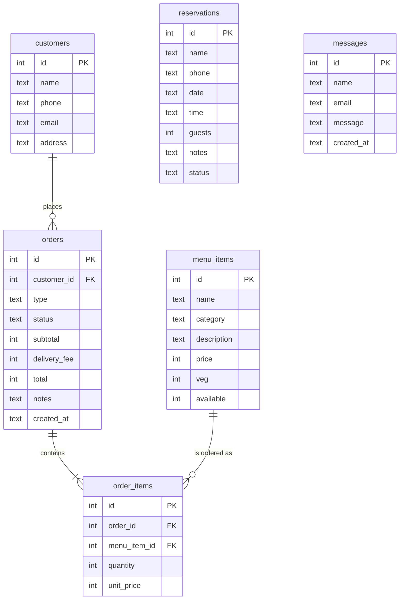

# Database design

`order_items.unit_price` stores the price at the time of the order, so old orders stay correct if the menu prices change.
The full SQL is in `database/schema.sql`; sample data is in `database/seed.sql`.
